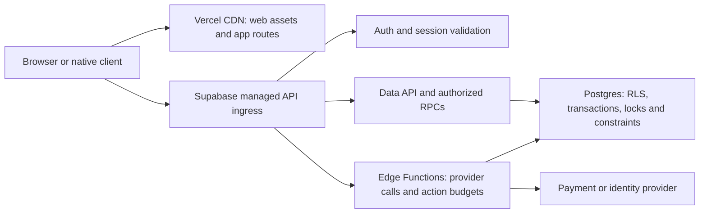

# WeHouse capacity validation

## Avoid duplicate browser traffic — 25 October 2026

Public web feed reads now share only in-flight work by deployment origin and
canonical query, with sixteen distinct requests allowed per tab. Forty identical
concurrent reads produce one fetch, while returning separate JSON objects to
consumers. No completed result is retained. Failure and overload do not trigger
a direct-database fallback. Tests cover canonical equivalence, response mutation
isolation, bounded distinct work, slot recovery and origin separation. Existing
private/text/geo/pagination/native exclusions remain unchanged.

Provider organization inspection confirms the current subscription is Free.
This is relevant infrastructure context; it does not isolate the cause of the
failed hosted ramp. No paid upgrade or capacity configuration was performed.

## Compressed repeat and response resource limits — 25 October 2026

Exact commit `1f34cb29be3d83f75dc28938af59fe1a74795064` passed its single-source
200-RPS stage (6,000 requests; 604ms p95; zero final errors, retries or drops),
then failed 500: 4,072 completed of 15,000 offered, 3,434 errors, 10,928 drops,
11,128ms p95. The test correctly stopped before 1,000.
The subsequent four-source repeat passed 10 RPS per source, then failed at
25 each: all 750 requests per source completed without final errors, but p95
was 7,477–7,669ms. The aggregate gate failed; no 800-RPS success exists.
These results remain failures and do not establish a database hard ceiling.
The matching provider-log window (24 October 23:01–23:02 UTC) contains 3,175
HTTP 200 entries; logs alone do not establish where the client delay occurred.

The gateway additionally limits each origin receipt to 2 MiB of decoded bytes,
checking actual streamed bytes rather than trusting Content-Length. Fixed
storage bounds tiny-chunk overhead. Oversized streams are cancelled, pending
slots released, and the response stays uncached. Malformed JSON/UTF-8 also
fails closed. Non-success HTTP bodies are cancelled without buffering or
revealing provider diagnostics. These are memory/connection safeguards, not
a substitute for a deployed CDN measurement or sustained mixed load.

## Public-feed boundary and expanded ramp — 24 October 2026

**Benchmark fidelity correction:** the native keep-alive transport introduced on
24 October did not initially negotiate compressed responses as browsers do.
A Test feed probe returned 21,650 decoded bytes versus 1,591 gzip bytes; the
identity attempt timed out on the local network. The transport now negotiates
gzip/deflate/Brotli and decodes each correctly, recording response-body wire
bytes, decoded bytes and negotiated encoding alongside latency/queue metrics.
Earlier native-transport results remain recorded as uncompressed workloads;
they cannot establish the limit for ordinary compressed browser traffic. No
latency, retry, drop, completion or dispatch threshold was relaxed.

The first four-generator run on c41b3997 passed 50 RPS per generator, then failed
100 RPS per generator. All four IDs were observed from four distinct source IPs
in provider logs. The aggregate summary failed and did not report 800 RPS. Those
runs also used the uncompressed transport and need a correctly negotiated repeat.
Vercel's deployment API now confirms HTTP 402 `resource_creation_blocked` because
the team has an overdue balance. The account owner must resolve that before a
fresh preview or real CDN measurement can be performed; no billing settings were
changed. The connector itself has recovered.

Repeat expanded run (`fbcffd6e`) passes 200 RPS (6,000/6,000, zero errors/retries/
drops; 186ms p95), but fails 500 with 11,240 drops, 3,240 failed logical requests
and substantial client queue/post-socket delay. 1,000 is not run. Do not call this
a database limit: post-socket timing also includes TLS, API ingress and network.

To distinguish one-generator pressure from many-client demand, the same workflow
now schedules four independent 200-RPS generators only after the single-generator
job finishes. Each keeps every lower stage and acceptance gate. The summary
requires four distinct generator IDs, identical versions and Test project,
independently passing reports and at least ten seconds of actual overlap among
their 200-RPS dispatch windows. Sequential runs cannot be added into an 800-RPS
claim, and no passing aggregate is emitted for incomplete/failed inputs. This
test is prepared, not yet measured. Generator User-Agents identify each shard
for comparison against provider ingress logs; no client identity is spoofed.

First expanded CI result (`f8507e32`): 200 RPS completed 6,000/6,000 with zero
errors/retries/drops and 232ms p95. At 500 RPS it completed 12,543/15,000, dropped
2,457 and reached 9,087ms p95; it stopped without running 1,000. This is a failure,
not higher-capacity proof. Its 256-socket generator ceiling can itself queue
traffic below the intended 1,000-RPS/2-second budget. The next run allows up to
2,048 sockets while retaining the 3,000 logical in-flight bound and every gate.
Reports now distinguish final-attempt client socket-queue time from time after
socket assignment. The latter includes connection/TLS/network/response work;
it is not database execution time. Full request latency still includes all
attempts and retry delays and remains the acceptance metric.

The separate disposable 50k-home/100k-Hotel run on `ec5f35ef` completed 400-client,
800-request bursts per endpoint without request errors. Measured throughput was
374–443 RPS for feed/filter endpoints and 790–925 RPS for detail endpoints.
These short closed-loop bursts do not establish sustained hosted capacity.

The working implementation adds `/api/public-catalog` for deployed web Home and
Hotel feeds. It calls the existing anonymous redacted search RPCs, never a raw
table, service-role client or arbitrary RPC. Only bounded public feed parameters
are accepted. Canonical GET queries let Vercel cache a successful response for
five seconds; browsers must revalidate. There is no stale-on-error extension.
Identical cold requests share an in-flight origin lookup, and each function
instance admits at most sixteen distinct misses. One failed shared lookup emits
one structured operator diagnostic containing only catalog kind, failure stage
and safe HTTP status, never caller tokens/cookies, search text or provider body.
These local controls supplement
the managed CDN; they are not a distributed rate limiter.

Typed text searches, precise coordinates, pagination, detailed property reads,
personal records, booking/availability quotes, payments, withdrawals and chat do
not use this shared cache. Native clients retain direct authorized RPCs. A public
feed can lag a change by up to five seconds; opening a listing or attempting a
booking still checks the authoritative database. Failed lookups are not cached
and do not trigger an automatic fallback request storm.

The API shares the existing environment boundary. Preview cannot select Production
through a supplied Host, token or cookie. It uses only the environment's public
key. Build/type checks now include the API directory. Gateway security, input
bounds, request collapse, overload, failure and client-routing tests pass; real
browser journeys exercise the same-origin route with intercepted synthetic
responses in both themes at four widths. These are not hosted-CDN performance
measurements. Vercel confirms an overdue-balance deployment block; the connector
has recovered, but real preview routing/cache headers and hit ratios remain unverified.
The legacy Netlify build remains intentionally ignored in `netlify.toml`.

The Test-only direct-origin benchmark now supports a bounded 1→5→10→25→50→100→
200→500→1,000 RPS ramp, thirty seconds per stage, stopping at the first failed
stage. Error, retry, dispatch, drop and p95 limits are unchanged. CI requests the
expanded ceiling; this is an intended test ceiling, not demonstrated capacity.
A local attempt on 24 October stopped at 1 RPS (20% retries; 21,139ms p95), so it
provides no evidence for the higher stages. Report generator/network saturation
separately from service saturation; do not lower gates to get a green result.

Official implementation references: [Vercel cache headers](https://vercel.com/docs/caching/cache-control-headers)
and [Node runtime Web handlers](https://vercel.com/docs/functions/runtimes/node-js).

## Request path and infrastructure boundary - 23 October 2026

At this earlier checkpoint, the browser client sent API requests directly to its environment's
Supabase URL. Vercel hosts the web build and applies the repository's asset/cache,
rewrite and security-header configuration. The new public-feed boundary above
supersedes this earlier all-direct request-path description; all other requests
remain direct.

Vercel's managed CDN provides routing and automatic DDoS mitigation for requests
that reach Vercel. It does not place a Vercel project firewall in front of direct
Supabase requests. Supabase Edge Functions have managed gateway ingress; gateway
presence does not establish a WeHouse-specific abuse budget on every API or RPC.
An added proxy URL alone would not close the direct origin path. Do not cache
private user data or distribute transactional booking/payment writes to stale
read replicas. Supabase read replicas are asynchronous and read-only; their
load-balancer endpoint and routing must be explicitly configured and verified
before changing the application's API endpoint. No replica was provisioned or
unlimited-capacity claim established by this review.

Found and repaired a concrete origin-side gap: the shared action-budget helper
previously defaulted to allowing requests when its database limiter was unavailable.
Payout withdrawal and payout-account callers relied on that default. The helper
now denies by default on errors, exceptions or malformed boolean receipts,
validates its budget arguments and returns bounded finite retry information.
An explicit fail-open option remains available for deliberately non-sensitive
uses; no current consumer uses it. Verification: 55 focused payment/payout/refund/
PMS checks and Deno type checking pass. The initial inventory request failed with
a connector transport error. The owner-requested retry succeeded: preserved
`verify_jwt=true` and deployed Test payout-account version 7 and payout-withdrawal
version 4 with the shared helper. Both full handlers pass Deno checks. Hosted POST
probes reject missing and invalid bearer tokens with HTTP 401 (four checks,
test-results/payout-edge-auth.json). No charge, refund or transfer was submitted.
Node's direct HTTP client failed to connect; the Windows HTTP client succeeded.
The function-source readback connector failed, so no remote source comparison is
claimed. Controlled authenticated limiter-outage/provider/ledger verification
remains internal work; gateway denial alone does not establish that behavior.

Platform references checked on 23 October:
[Vercel CDN](https://vercel.com/docs/cdn),
[Supabase Edge Functions](https://supabase.com/docs/guides/functions),
[Supabase read replicas](https://supabase.com/docs/guides/platform/read-replicas).
Configured project firewall rules, backend ingress limits, connection/pool
ceilings and real mixed transactional capacity still require deployed inspection
and the measured exercises below. A managed network layer does not close those
engineering checks.

## What “one million users” must mean

Report registered accounts, daily active accounts, concurrent foreground sessions, open Realtime connections, and completed business actions per second separately. One million simultaneous foreground sessions taking one action every 30 seconds means roughly 33,333 actions per second before page resources, session checks, notifications, and chat fan-out. Ten and one hundred million under the same assumption mean roughly 333,333 and 3,333,333 actions per second. A 30-second ramp measures a burst, not steady capacity.

## Current evidence (28 September 2026)

- Hosted WeHouse Test (`qoobnkedfyosnizrlttt`): 1,000 synthetic apartments and 1,000 synthetic hotels/rooms; 0 Auth users. A prior 450-request anonymous catalog run at 1, 2, then 5 requests/s had no errors or dropped work; 5 requests/s p95 was 246 ms.
- Disposable local database: 50,000 homes, 100,000 hotels, 50,000 profiles. A prior 1,560-request mixed catalog read at 2/5/10 requests/s had no errors; a separate 400-client read run found hotel price p95 about 3.96 seconds.
- Neither exercise used signed-in sessions, real booking writes, encrypted message delivery, payment sandbox webhooks, Realtime connections, notification delivery, media/CDN, or a million users. The “million” preset means catalog rows and has not been run.

## Required mixed journey in an isolated capacity environment

Create disposable, confirmed synthetic Auth accounts with customer, Property Partner, Hotel Team, Worker, and staff grants. Seed distinct available room nights and homes, conversations and encryption keys for actor pairs, and a processor sandbox that can replay success, duplicate, delayed, and failed callbacks. Do not run the write workload against production or real customers. Tag every generated record for cleanup; never use live payment credentials.

Use a stated traffic mix and record per-journey outcomes. Initial proposed mix: 55% discovery/detail and media; 10% sign-in/session restoration; 15% booking availability, reservation and competing checkout; 10% Inbox open, private message send/read and reconnect; 5% sandbox payment plus webhook reconciliation; 5% cancellation, refund review, notifications and receipt. Measure the browser as well as API/RPC and database. Count all downstream requests per journey, including the current session guard and unread-summary calls. Measure connected but idle users separately from actively sending users.

Run a preflight with 10 actors, then 100 and 1,000, sustaining each step for at least 10 minutes and repeating a one-hour soak after stability. Increase only after the previous stage meets the gate. Larger stages require measured per-session cost, load generators in multiple regions, capacity and budget agreements with Supabase, Vercel, Realtime, and the payment provider. A 1m→10m→100m simultaneous-user ramp every 30 seconds is not an acceptable capacity proof or a safe test on this Test project.

Proposed release gates to agree before a run: observed request rate within 5% of offered load; unexpected journey failures under 0.1%; p95 public discovery under 2 seconds and p95 authenticated booking/message operations under 3 seconds; no double-booked room night or duplicated payment/refund under races and webhook replay; no message cross-account disclosure; no unreconciled paid booking; and a recovery drill after a database or Realtime interruption. Record p99, queue age, DB CPU/IO, locks, connection and Realtime limits, egress, CDN hit rate, and per-journey cost. Exclude expected policy rejections from the error numerator but report them separately.

## Known scale blockers to address before large stages

- The signed-in app refreshes unread summaries with several database calls and a 60-second fallback. Session guarding reads a user session about every 30 seconds and writes last-seen for an active one. Even idle foreground users therefore generate sustained database work.
- Chat currently uses Postgres Changes subscriptions on message tables, some without recipient filters. A conversation has a scoped subscription; the global Inbox and app counters still need a user-targeted delivery design. Supabase recommends private Broadcast for larger Realtime workloads. Verify authorization and delivery under reconnect before replacing the current path.
- Test has no Auth users, so an authenticated mixed load result cannot honestly be reported yet. Payment sandbox webhooks and representative actors must be installed and verified before that run.

Reference: [Supabase Realtime limits](https://supabase.com/docs/guides/realtime/limits) and [database change delivery guidance](https://supabase.com/docs/guides/realtime/subscribing-to-database-changes).

## 19 October 2026: current fixture check and stricter catalog checker

Read-only Test inspection confirmed 1,000 capacity-stage homes, 1,000 capacity-stage hotels and **zero Auth users**. This is synthetic catalog data, not evidence of customer concurrency. The later historical 200-RPS catalog result and its exact commit are recorded in the existing release roadmap; it does not replace mixed-journey testing.

The catalog checker now requires all distinct routes to finish warm-up, overall and per-route p95 at most 2,000 ms, zero final errors/drops, at most 1% retried requests, complete per-route sample accounting and a measured dispatch rate within 5% of its target. It stops increasing traffic after a failed stage and saves its failure reasons. Reports include time, CI SHA when available, scope, thresholds and an overall result. Fixed an expired-warm-up path that could skip a contract, and the failure report's invalid literal newline escape. The new gates have four passing unit tests. **No new hosted load run has been performed with these gates.** Existing results lack the new dispatch measurement and must not be relabelled as passes of this revised checker.

These 30-second anonymous stages are a catalog smoke benchmark. Whole-product capacity still requires the isolated signed-in booking/message/payment mix, sustained and soak runs, races/recovery, browser/media delivery, resource ceilings and cost measurements described above. The thresholds are the current engineering check defaults, not a promise of a supported user count.
